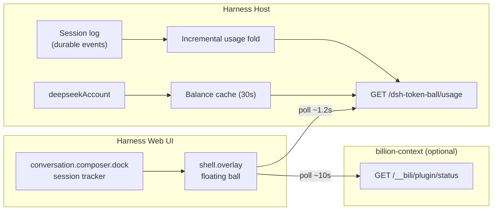

<div align="center">
  
  <h1>Token Ball</h1>
  <p><strong>把每一次对话的 Token、花费和余额，放在手边。</strong></p>
  <p>A draggable floating ball for DeepSeek Harness that shows the current conversation's tokens, estimated cost, and DeepSeek account balance.</p>
  <p>
    <a href="./LICENSE"></a>
    
    
  </p>
</div>

---

<details>
<summary><strong>English overview</strong></summary>

Token Ball is a DeepSeek Harness plugin that puts the cost of the current
conversation at the edge of your screen. It shows total tokens, an estimated
CNY cost based on DeepSeek's published peak/off-peak prices, and the signed-in
account's recharge and bonus balances. When the “上下文” panel
(`billion-context`) is installed, it also adds a context-pressure ring and a
compact sent/compressed-token breakdown. The ball can be dragged, remembers its
position, and refreshes about once a second. Everything is computed on the
local Host; conversation content is never sent to the plugin's endpoint.

It is an estimate, not an invoice. Actual charges remain authoritative on the
DeepSeek Platform.

</details>

## 它是什么

在 DeepSeek Harness 里，Token 用量通常藏在对话详情中，账户余额又在设置页里。写代码、跑 Agent 时，往往要来回切换，才能回答三个很实际的问题：

- 这次对话已经用了多少 Token？
- 按官方价格，大概花了多少钱？
- 账户里还剩多少钱？

**Token Ball** 把这三个数字做成一个可以拖动的悬浮球，常驻在 Harness 界面上。它不打断对话，也不需要打开新页面：扫一眼就能看到，点开能看明细。

> 这是给 DeepSeek Harness 使用的插件，不是独立的桌面记账软件。
>
> 更完整的产品定位、用户场景与设计取舍见 [docs/PRODUCT.md](./docs/PRODUCT.md)。

## 功能

- **当前会话实时用量**：输入、输出、缓存命中、请求数。
- **预估人民币花费**：按 DeepSeek 官方峰谷价目计算，区分高峰与空闲时段。
- **真实账户余额**：读取 DeepSeek 账号的充值余额与赠金余额。
- **上下文压力环**：安装 `billion-context`（“上下文”面板）后，球体外圈显示当前上下文占用比例，球体底部显示百分比。
- **上下文明细**：展开卡片可看已用 / 上限、实际发送、压缩累计节省、压缩块数量，以及系统提示、工具、消息、代码、摘要的 Token 构成。
- **可选联动**：没有安装“上下文”插件时，相关 UI 自动隐藏，不影响原有功能。
- **悬浮球交互**：拖动移动、点击展开、再次点击收起，位置会记住。
- **近实时刷新**：约 1.2 秒轮询一次；上下文约 10 秒轮询一次；余额最多缓存 30 秒。
- **跟随主题**：使用 Harness 的 `--dsw-alias-*` 主题变量，适配明暗主题。
- **不上传对话**：所有计算都在本机完成，只读取用量、余额和上下文的聚合数字。

## 一次对话，一眼看清

悬浮球收起时只显示预估花费；展开后是一张紧凑的状态卡：

| 指标 | 含义 |
| --- | --- |
| `¥0.0842` | 当前会话的预估花费（CNY） |
| `1,234,567 tokens` | 当前会话总 Token |
| 输入 / 输出 | prompt tokens / completion tokens |
| 缓存命中 | 命中缓存的输入 Token 与占比 |
| 请求数 | 当前会话已完成的模型请求数 |
| `上下文 6.4%` | 当前上下文占用（已用 / 上限），外圈同步显示 |
| `发送 58.3K` | 本次实际发送给模型的 Token（压缩后） |
| `压缩节省 474K · 5 个压缩块` | 已从上下文中压缩释放的 Token 与活跃压缩块 |
| 账户余额 | 充值余额 + 赠金余额 |
| 高峰 / 空闲价 | 当前生效的计费时段 |

## 与「上下文」插件协同

这里的“上下文”指 Harness 里的 **`billion-context`** 面板（标签为“上下文”，内部 id 为 `bili-context`）。Token Ball 会自动探测它，不需要额外配置：

- 通过 Host 的 `/bili/origin` 找到本地上下文服务，再读取
  `/__bili/plugin/status?conversationId=<sessionId>`。
- 每 10 秒刷新一次；页面隐藏时暂停，回到前台立即刷新。
- 只解析聚合字段：`contextTokens`、`contextLimit`、`contextView.sentTotal`、
  `contextView.categories`、`contextView.folds` 与 `blocks`。
- “详情”链接会打开该会话对应的上下文面板；没有 `webUrl` 时不显示链接。
- 没有安装 `billion-context`、服务不可达或返回格式不完整时，整块 UI 自动隐藏，悬浮球仍按原逻辑工作。

> 适配的是显示层，不复制、不缓存上下文正文。会话摘要、消息内容等字段不会进入 Token Ball 的 Host 路由或余额请求。

## 快速开始

### 环境要求

- 已安装 DeepSeek Harness（桌面版或带 `deepseekAccount` 的 Web 版）。
- 已在 Harness 中登录 DeepSeek 账号，或配置了可用的 DeepSeek API Key。
- 插件开发和验证于 `0.2.1-rc.2`，使用 Harness 的 `shell.overlay`、`conversation.composer.dock` 与 `deepseekAccount` 接口。

### 安装

1. 下载或克隆本仓库到本机。
2. 打开 Harness 的 **Plugins** 页面，选择从本地目录安装，指向本仓库根目录。
3. 安装完成后刷新一次 Harness 页面，右下角会出现悬浮球。
4. 首次加载如果余额显示“读取中”，等下一次轮询即可。

如果使用 Agent 安装，调用 `plugin_manager` 的 `install_bundle`，把 `target` 设为本仓库的绝对路径即可。

> 修改 Host 侧代码（`index.js`、`cost.js`）后需要重启 Harness；只改 `client.js` 时刷新页面即可。

## 计费口径

默认价格来自 DeepSeek 官方价目（CNY / 1M tokens，`[空闲, 高峰]`）：

| 模型 | 缓存命中输入 | 缓存未命中输入 | 输出 |
| --- | --- | --- | --- |
| `deepseek-flash` | 0.02 / 0.04 | 1 / 2 | 4 / 8 |
| `deepseek-v4-pro` | 0.15 / 0.30 | 4.5 / 9 | 13.5 / 27 |

- **高峰时段**：北京时间周一至周五 `09:00–12:00`、`14:00–18:00`；其余时间按空闲价。
- **Token 口径**：`inputTokens` 按缓存未命中计；`cacheReadTokens` 按缓存命中计；`cacheWriteTokens` 按未命中计；`outputTokens` 按输出计。
- **缓存命中价**只适用于 `cacheReadTokens`，不会重复计算普通输入。
- **未知模型**回退到 `deepseek-flash` 价格，并计入 `unpricedCalls`，页面仍会显示预估值。
- **法定节假日**暂未建模，节假日会按普通工作日峰谷时段计算。

价格可以在 Harness 的 profile patch 中覆盖，修改后重启 Harness 生效：

```yaml
- id: dsh-token-ball
  config:
    prices:
      deepseek-flash:
        cacheHit: [0.02, 0.04]
        cacheMiss: [1, 2]
        output: [4, 8]
```

> 页面显示的是**估算值**，不是平台账单。实际扣费以 DeepSeek 开放平台账单为准。

## 它是怎么工作的



- **Host** 增量读取会话日志中的 `assistant/message.usage`，只处理新事件；冷启动时从日志完整回放。
- **Host** 通过 `deepseekAccount.getBalance()` 读取真实余额，并做 30 秒缓存与并发合并。
- **Client** 在 `conversation.composer.dock` 里放一个无渲染的会话跟踪器，把当前 `sessionId` 交给 `shell.overlay` 中的悬浮球。
- **Client** 可选地读取 `billion-context` 的本地状态端点；只解析上下文占用、发送量、压缩与分类占比等聚合字段。
- 悬浮球不碰对话正文、附件或凭据；上下文正文不会进入悬浮球的请求链。

## 隐私与边界

- 余额由 Harness 的账号服务在本机查询，插件**不保存 Token、Cookie 或 API Key**。
- `/dsh-token-ball/usage` 只返回聚合数字与会话 ID，不返回消息内容。
- 上下文联动只读取 `billion-context` 的聚合状态；不会把摘要、消息或工具输出写入 Token Ball 的 Host 路由。
- 只统计**当前会话**；subagent 是独立会话，不会自动计入父会话。
- 目前没有跨会话汇总、历史趋势或预算告警。
- 余额刷新有延迟，和平台账单可能存在时间差。

## 开发

插件没有构建步骤，Host 与 Client 都是原生 ESM / 浏览器模块：

```bash
node --check index.js
node --check cost.js
node --check client.js
```

仓库结构：

```text
.
├─ index.js              # Host: usage route, session fold, balance cache
├─ cost.js               # Pricing, peak window, usage arithmetic
├─ client.js             # Client: floating ball + session tracker
├─ cordis.patch.yml      # Bundle patch
├─ locale/{en,zh}.json   # Plugin display metadata
├─ icon.svg              # Original artwork
└─ docs/PRODUCT.md       # Product one-pager
```

## Roadmap

- [ ] 会话历史与按天/按模型的成本趋势
- [ ] 预算阈值与超额提醒
- [ ] 将 subagent / 子会话成本汇总到父会话
- [ ] 价格表在线更新与自定义模型映射
- [ ] 真实界面截图与短视频演示

## License

[MIT](./LICENSE)
